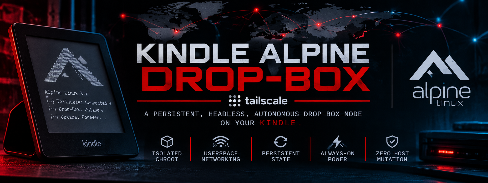

<p align="center">
  
</p>

# Kindle Alpine Tailscale Drop-Box (`kindle-alpine-dropbox`)

Turn a jailbroken Kindle into a persistent, headless, autonomous Tailscale drop-box node running an isolated Alpine Linux chroot environment.

## Overview

This project allows you to run a lightweight Alpine Linux chroot container directly on a Kindle's user storage (`/mnt/us/`), leveraging Tailscale in userspace-networking mode (`--tun=userspace-networking`) to bypass kernel limitations. By managing power states via `lipc`, the device stays awake, keeps its Wi-Fi radio active, and maintains an uninterrupted connection to your tailnet indefinitely.

## Features

- **Isolated Chroot Environment:** Runs a full Alpine Linux container on top of an `alpine.ext3` virtual disk image.
- **Userspace Networking:** Utilizes Tailscale's userspace networking engine, requiring no kernel tun/tap module modifications.
- **Persistent State:** Retains node authentication and state inside the container image for seamless reconnections.
- **Always-On Power Management:** Overrides Kindle power saving and screensaver timeouts to maintain a continuous Wi-Fi link.
- **Zero Host Mutation:** Avoids messy system modifications; all runtime mounts occur dynamically in `/tmp`.

## Repository Structure

```text
├── scripts/
│   └── build_rootfs.sh       # Multi-distro chroot image generator script
├── setup-dropbox.sh          # Bootstrap installer script for fresh environments
├── start-alpine-dropbox.sh   # Runtime launcher script (mounts, binds, and starts Tailscale)
└── cleanup-dropbox.sh        # Complete teardown and system reversion script

```

## Prerequisites

### On the Kindle

* A jailbroken Kindle with KUAL, terminal access (`kterm`), and root SSH enabled.
* Install this using the kindle search bar and enable ssh access
```bash
;kpm install jobman

```
* Basic familiarity with SSH and command-line file transfers (`sftp` or USB transfer).

### On Your Workstation (For Building the Image)

Because virtual disk images exceed standard Git file size limits, you will generate the `alpine.ext3` image locally using the provided build script.

First, install the required host dependencies depending on your OS:

```bash
# Arch Linux
sudo pacman -S debootstrap qemu-user-static qemu-user-static-binfmt debian-archive-keyring

# Ubuntu / Debian
sudo apt install debootstrap qemu-user-static binfmt-support

# macOS (use Docker)
# See docs/docker-build.md

```

---

## Installation & Setup

### Step 1: Generate the `alpine.ext3` Image Locally

Clone your repository and run the build script on your workstation:

```bash
sudo ./scripts/build_rootfs.sh

```

*(You can run it without arguments for an interactive menu to choose Alpine, Debian, Arch, or Void, or run it directly for Alpine via command-line flags).*

### Step 2: Transfer Files to the Kindle

Copy your generated `alpine.ext3` image along with `setup-dropbox.sh`, `start-alpine-dropbox.sh`, and `cleanup-dropbox.sh` into the root of your Kindle's user storage (`/mnt/us/`) via USB or SFTP.

### Step 3: Run the Bootstrap Installer

SSH into your Kindle and execute the setup script to install runtime dependencies (`tailscale`, `bash`, `curl`) inside the chroot:

```bash
sh /mnt/us/setup-dropbox.sh

```

### Step 4: Authenticate Tailscale (First Run Only)

Run the startup script manually the first time to authenticate against your tailnet:

```bash
sh /mnt/us/start-alpine-dropbox.sh

```
### Step 5: First-Time Tailscale Authentication
Because Tailscale requires an interactive login link the first time it connects to your tailnet, do **not** run the background startup script yet. Instead, enter the container shell manually to authenticate:

1. Enter the Alpine chroot environment:
   ```bash
   chroot /tmp/alpine /bin/sh
   tailscale up 

Follow the interactive auth URL provided in the console to authorize your Kindle node on your Tailscale admin console. Once authenticated, the state is permanently saved inside your `alpine.ext3` image.

---

## Usage

To spin up your drop-box node after a reboot:

1. SSH into your Kindle:
```bash
ssh root@<YOUR_KINDLE_IP>

```


2. Execute the launcher script:
```bash
sh /mnt/us/start-alpine-dropbox.sh

```


The script will automatically mount the virtual filesystem, bind essential devices (`/dev`, `/proc`, `/sys`), start `tailscaled` in the background, bring the interface up, and lock the screen active to prevent your Wi-Fi from dropping.

*Note: You need to run the launcher script once every time the Kindle boots up.*

### Teardown & Cleanup

If you ever want to completely wipe the drop-box environment, unmount everything, and return your Kindle back to a standard jailbroken state, simply run:

```bash
sh /mnt/us/cleanup-dropbox.sh

```

---

## Credits & Acknowledgements

- **Chroot Build Script:** Adapted from [kindle-linux-chroot](https://github.com/Sqrilizz/kindle-linux-chroot) by **[Sqrilizz](https://github.com/Sqrilizz)**.
- **Kindle Tooling:** 
  - KUAL by **knc1**
  - kterm by **bfabiszewski**
- **Community:** The Kindle jailbreak community at MobileRead & Dammit Jeff.

## Contributing

PRs welcome! 

**Automation Notes:**
- CI (`.github/workflows/ci.yml`) runs `shell shellcheck` plus full smoke builds of Debian, Alpine, Void, and a resize-tool test on every push.
- If your shell script changes, run `shellcheck` locally first—CI is strict.

## License

Distributed under the MIT License. See `LICENSE` for more information.
